# Diagrama Entidade-Relacionamento (DER) e Dicionário de Dados

> **Projeto Integrador — Análise e Desenvolvimento de Sistemas (SENAC EAD) · Grupo 43**  
> Modelagem oficial em **PostgreSQL 17 + PostGIS** (gerenciada via Prisma ORM).

---

## 1. Diagrama Entidade-Relacionamento (DER)

```mermaid
erDiagram
    User ||--o{ RefreshToken : "possui"
    User ||--o{ PasswordResetToken : "solicita"
    User ||--o{ Address : "cadastra"
    User ||--o{ DeviceToken : "registra"
    User ||--o| CooperativeMember : "vincula-se"
    User ||--o{ PickupRequest : "solicita (Requester)"
    User ||--o{ PickupRequest : "executa (Collector)"
    User ||--o{ PickupStatusHistory : "altera status"
    User ||--o{ Notification : "recebe"
    User ||--o{ MaterialGuideView : "consulta"

    Region ||--o{ Address : "agrupa"
    Region ||--o{ CollectionPoint : "contém"
    Region ||--o{ CollectionSchedule : "define calendário"
    Region ||--o{ ScheduleException : "possui exceções"
    Region ||--o{ CooperativeRegion : "atendida por"
    Region ||--o{ PickupRequest : "delimita"

    Cooperative ||--o{ CooperativeRegion : "atua em"
    Cooperative ||--o{ CooperativeMember : "possui membros"
    Cooperative ||--o{ CollectionPoint : "gerencia"
    Cooperative ||--o{ PickupRequest : "atende"

    MaterialCategory ||--o{ Material : "classifica"
    MaterialCategory ||--o{ CollectionPointCategory : "aceita em"
    MaterialCategory ||--o{ PickupRequestItem : "categoriza pedido"
    MaterialCategory ||--o{ PickupCollectedItem : "categoriza coleta"

    Material ||--o{ MaterialGuideView : "contabiliza acesso"

    CollectionPoint ||--o{ CollectionPointCategory : "recebe"
    CollectionPoint ||--o{ CollectionPointHours : "funciona em"

    PickupRequest ||--o{ PickupRequestItem : "contém itens"
    PickupRequest ||--o{ PickupCollectedItem : "registra recolhidos"
    PickupRequest ||--o{ PickupStatusHistory : "registra histórico"

    Notification ||--o{ NotificationDelivery : "enfileira envio"
```

---

## 2. Dicionário de Dados (23 Modelos / Tabelas)

### Módulo 1: Identidade e Autenticação

| Tabela | Descrição | Chaves e Colunas Principais |
| :--- | :--- | :--- |
| **`User`** | Cadastro central de usuários da plataforma (moradores, comerciantes, gestores, coletores, educadores e admins). | `id` (UUID, PK), `name`, `email` (Unique), `phone`, `passwordHash`, `role` (Enum `Role`), `lgpdConsentAt`, `active`, `deletedAt`, `createdAt`, `updatedAt`. |
| **`RefreshToken`** | Controle de renovação de sessão JWT com rotação e revogação. | `id` (UUID, PK), `userId` (FK → `User`), `tokenHash` (Unique), `expiresAt`, `revokedAt`, `createdAt`. |
| **`PasswordResetToken`** | Tokens temporários de uso único para redefinição de senha por e-mail. | `id` (UUID, PK), `userId` (FK → `User`), `tokenHash` (Unique), `expiresAt`, `usedAt`, `createdAt`. |
| **`Address`** | Endereços vinculados aos usuários, com coordenadas geográficas e associação automática à região-polo. | `id` (UUID, PK), `userId` (FK → `User`), `regionId` (FK → `Region`), `label`, `zipCode`, `street`, `number`, `complement`, `neighborhood`, `city`, `state` (Char 2), `latitude`, `longitude`, `isPrimary`. |
| **`DeviceToken`** | Tokens de dispositivos móveis/web (`IOS`, `ANDROID`, `WEB`) para envio de notificações push. | `id` (UUID, PK), `userId` (FK → `User`), `token` (Unique), `platform` (Enum `DevicePlatform`), `createdAt`. |

---

### Módulo 2: Catálogo, Regiões e Pontos de Coleta

| Tabela | Descrição | Chaves e Colunas Principais |
| :--- | :--- | :--- |
| **`Region`** | Regiões-polo atendidas pelo sistema, delimitadas por lista de bairros ou raio geográfico. | `id` (UUID, PK), `name`, `city`, `state` (Char 2), `neighborhoods` (`String[]`), `centerLatitude`, `centerLongitude`, `radiusKm`, `active`. |
| **`MaterialCategory`** | Categorias principais de resíduos recicláveis (ex.: Papel, Plástico, Vidro, Metal, Eletrônicos). | `id` (UUID, PK), `name` (Unique), `slug` (Unique), `color`, `icon`, `description`. |
| **`Material`** | Itens específicos do guia educativo de descarte, com instruções de preparo e sinônimos para busca. | `id` (UUID, PK), `categoryId` (FK → `MaterialCategory`), `name`, `recyclable` (Boolean), `preparation`, `notes`, `synonyms` (`String[]`), `searchText`, `active`. |
| **`MaterialGuideView`** | Log de visualizações do guia de materiais para métricas de engajamento e educação ambiental. | `id` (UUID, PK), `materialId` (FK → `Material`), `userId` (FK → `User`, opcional), `viewedAt`. |
| **`CollectionPoint`** | Ecopontos, PEVs, cooperativas e comércios parceiros que recebem materiais recicláveis. | `id` (UUID, PK), `regionId` (FK → `Region`), `cooperativeId` (FK → `Cooperative`), `name`, `type` (Enum `CollectionPointType`), `street`, `number`, `neighborhood`, `city`, `state`, `latitude`, `longitude`, `geo` (`geography(Point, 4326)` - índice GiST), `instructions`, `phone`, `active`. |
| **`CollectionPointCategory`** | Tabela associativa (N:N) entre pontos de coleta e categorias de materiais aceitas. | `collectionPointId` (PK, FK